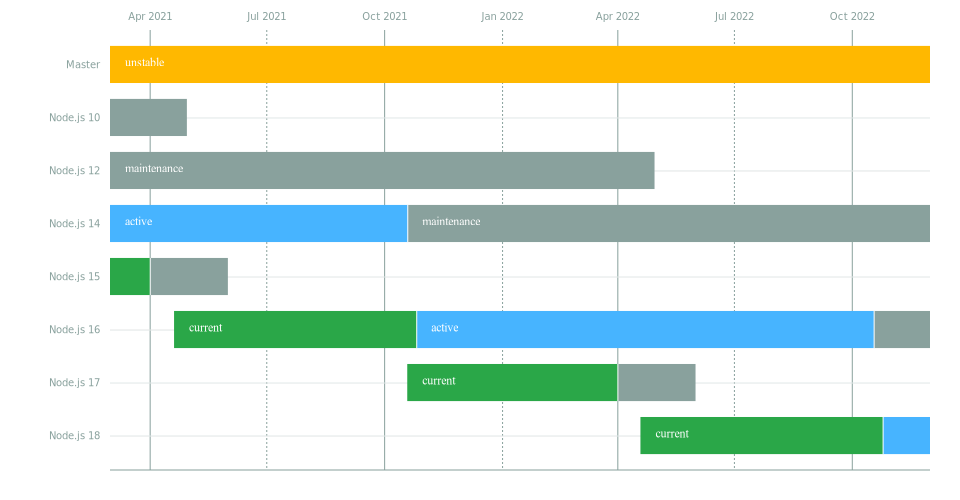

Já podemos criar funções lambdas na AWS utilizando o runtime Node.js 14.x, fazer esse upgrade vai trazer alguns benefícios para os seus projetos e sobre isso que vamos falar hoje.

Você ainda está usando os runtimes **Node.js 6.x, Node.js 8.x ou Node.js 10.x**?


## Você precisa sair do Node.js 10.x



(Source: [https://nodejs.org/en/about/releases/](https://nodejs.org/en/about/releases/))

O tempo voa quando estamos nos divertindo, certo?

Acredito que o mesmo acontece com as versões LTS (long-term support) do Node.js. O tempo de vida da versão Node.js 10.x já acabou, essa versão estava recebendo atualizações de segurança pelo core do time do Node.js até os meados de abril de 2021, como vocês podem ver na imagem do calendário das releases acima.

Com a versão 10.x chegando ao fim de sua vida, logo não vamos conseguir fazer deploy dessa versão. Mas você não precisa se desesperar fazer um upgrade de versão costuma ser bastante simples e minha recomendação é que você pule direto para 14.x.


## Principais vantagens em adotar o Node.js 14.x na minha opinião

De tudo que foi anunciado no texto "[Node.js version 14 available now](https://nodejs.medium.com/node-js-version-14-available-now-8170d384567e)" escrito por **Michael Dawson** e **Bethany Griggs** no blog oficial da comunidade as funcionalidades abaixo foram as que mais chamaram a minha atenção.


### V8 vou atualizado para versão V8 8.1

Além do aumento de desempenho que as releases do V8 costumam trazer e a comunidade estar comentando muito sobre as funcionalidades **Intl.DateTimeFormat **e **Intl.DisplayNames**, o que mais gostei dessa nova atualização foram as funcionalidades **Optional Chaining**, imagino que elas vão reduzir e muito a maneira como lemos os nossos códigos em JavaScript (lembrando que elas já existem em outras linguagens como TypeScript e Kotlin).


#### Optional Chaining

Use este operador para acessar o valor de uma propriedade dentro de uma cadeia sem a necessidade de validar cada referência. Isso remove a necessidade de verificar a existência de uma propriedade usando o operador **&&** ou** lodash.get**.

```
const campaign = {
   id: "42dce441-0871-4d8b-8e39-9f22c7233fe7",
   costCenter: "TI9815",
   completed: "true",
   totalUsers: 100,
   successfulStatus: 90,
   params: {
       startDate: "26/03/2021;10:00;20:00",
       title: "My Title",
       message: "My message",
       action: "OPEN_APP",
       url: ""
   }
}
```

Vamos imaginar que para enviar uma push notification para um cliente precisamos trabalhar com o modelo de objeto **campaign** acima e os valores que precisamos acessar estão na propriedade **params**.

Toda campanha é obrigada a informar **startDate, title, message e action**. Nosso sistema precisa validar esses valores.

```
if(campaign && campaign.params && campaign.params.startDate) {
   // faz alguma coisa aqui
}
```

É muito comum escrevermos o código acima para evitar um error de **undefined** ou **null**. Usando Optional Chaining a coisa fica bem mais simples, veja:

```
if(campaign?.params?.startDate) {
   // faz alguma coisa aqui
}
```

### Node "Diagnostic Reporting" se tornou estável

Todo tipo de relatório que possa melhorar a qualidade do meu processo de monitoramento chama minha atenção. Ainda mais quando falamos de AWS Lambda e sistemas distribuídos.

Essa funcionalidade cria um grande JSON com diversas informações de como a máquina como, por exemplo, uso de CPU e memoria. Consegue nos informar se estamos sofrendo problema de desempenho ou vazamento de memória, além de ter uma stack trace muito maior.

Christopher Hiller nos apresentou essa funcionalidade ano passado, recomendo assistir à palestra dele (link nas referências).


## Atualizando o runtime pelo Serverless Framework

Tenha certeza de estar usando a versão 14.x no seu ambiente:

```
nvm use v14
```

Atualize o runtime no arquivo **serverless.yml **conforme o exemplo abaixo:

``` \
provider:
  name: aws
  runtime: nodejs14.x
```

Adicione um atributo enignes no seu package.json só para garantir que as outras pessoas do seu time também vão utilizar node 14.x para evitar problemas de execução.

``` \
"engines": {
    "node": ">=14.0.0"
  },
```

## Conclusão

A maioria das aplicações em produção utilizam as versões LTS, por isso é altamente recomendável que você atualize qualquer aplicação ou AWS Lambda que está atualmente usando a versão Node.js 6.x para o Node.js 10.x, a versão LTS mais recente do momento.

Crie a cultura de manter não apenas o node como também suas dependências atualizadas, evitando surpresas como quebra de versão e problemas de segurança.
